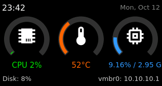
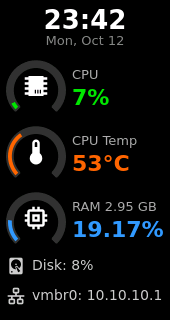

# AceMagic S1 Home Server Dashboard

[Русская версия](README.ru.md)

A home server dashboard theme for the AceMagic S1 front LCD, built for
[s1panel](https://github.com/tjaworski/AceMagic-S1-LED-TFT-Linux).
One theme holds two layouts — landscape (320×170) and portrait (170×320, metrics stacked in a column).
Switch the orientation in the web UI (`http://<host>:8686` → Orientation) and the matching layout is applied automatically.

Originally made for the `firebat` home server (Proxmox VE 9).

## Screenshots

| Landscape | Portrait |
|---|---|
|  |  |

Shows: clock and date, CPU load, CPU temperature, RAM usage, root disk usage and the `vmbr0` IP address.

## Contents

| File | Description |
|---|---|
| `install.sh` | Installer for another device (creates `*.bak-<date>` backups) |
| `themes/homeserver/landscape_dashboard.json` | The theme: `widgets` is the active layout, `widgets_landscape` / `widgets_portrait` holds the other one |
| `icons/mdi/*.svg` | Icons stored locally (no requests to api.iconify.design) |
| `patches/s1panel-dual-layout-local-icons.patch` | s1panel code changes (`api.js`, `widgets/iconify.js`) |
| `patched/` | Already patched `api.js` and `widgets/iconify.js` (fallback if the patch does not apply) |
| `config.example.json` | Full `config.json` from the original server, for reference |
| `portrait_dashboard.gen.py` | Script that generates the portrait layout (positions, fonts, colors) |
| `screenshots/` | Screenshots for this README |

## Installation

s1panel must already be installed on the target device (default path `/opt/acemagic/s1panel`).

```sh
git clone https://github.com/LEmanRUS17/firebat_s1_lcd_theme.git /tmp/s1theme
sh /tmp/s1theme/install.sh
# custom install path: sh install.sh /path/to/s1panel
```

The script:
1. backs up `api.js`, `widgets/iconify.js`, `config.json` and the theme;
2. applies the patch (if it does not apply cleanly, copies the files from `patched/`);
3. copies the theme and the icons;
4. makes the theme active in `config.json` and adds the `network` (vmbr0) and `space` (root) sensors if they are missing;
5. restarts `s1panel`.

Running it again is safe.

## s1panel code changes

- **`api.js` → `set_orientation`**: when the orientation changes, the current widgets are stored in
  `widgets_<old>` and `widgets_<new>` is moved into `widgets`. Themes without a second layout behave as before.
- **`widgets/iconify.js`**: an icon is first looked up in `icons/<set>/<name>.svg`; if it is missing, it is
  downloaded from api.iconify.design and saved there.

## Notes

- After switching the orientation in the web UI, reload the page (F5) before editing widgets —
  the editor does not re-read the widget list by itself.
- The network interface is `vmbr0`. If yours is named differently, change `network_vmbr0` in the theme
  and `interface` in `config.json`.
- Updating s1panel from its repository overwrites `api.js` and `iconify.js` — run `install.sh` again after an update.

## License

GPL-3.0, same as [s1panel](https://github.com/tjaworski/AceMagic-S1-LED-TFT-Linux),
which the modified `api.js` and `widgets/iconify.js` are based on (© Tomasz Jaworski).
Icons: [Material Design Icons](https://pictogrammers.com/library/mdi/) (Apache-2.0).
